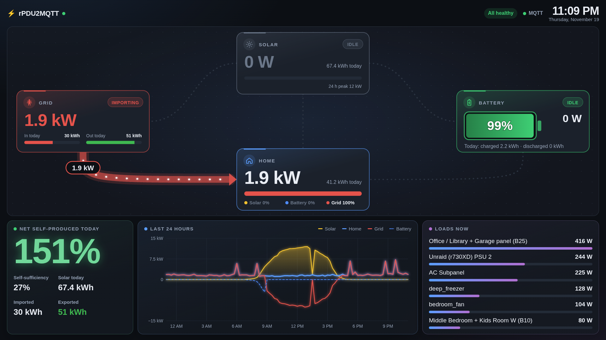
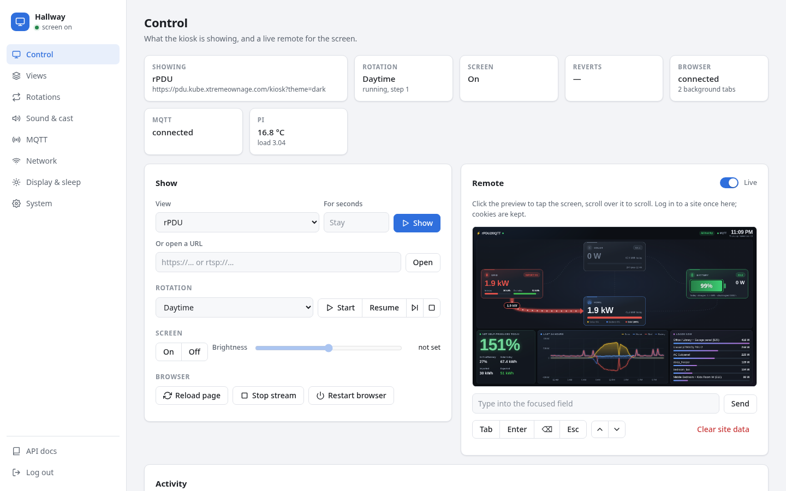
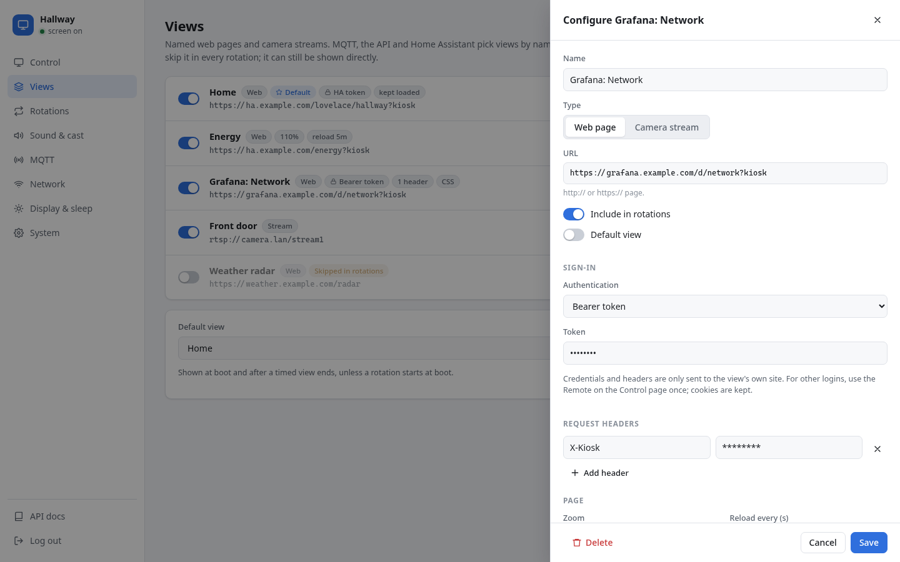
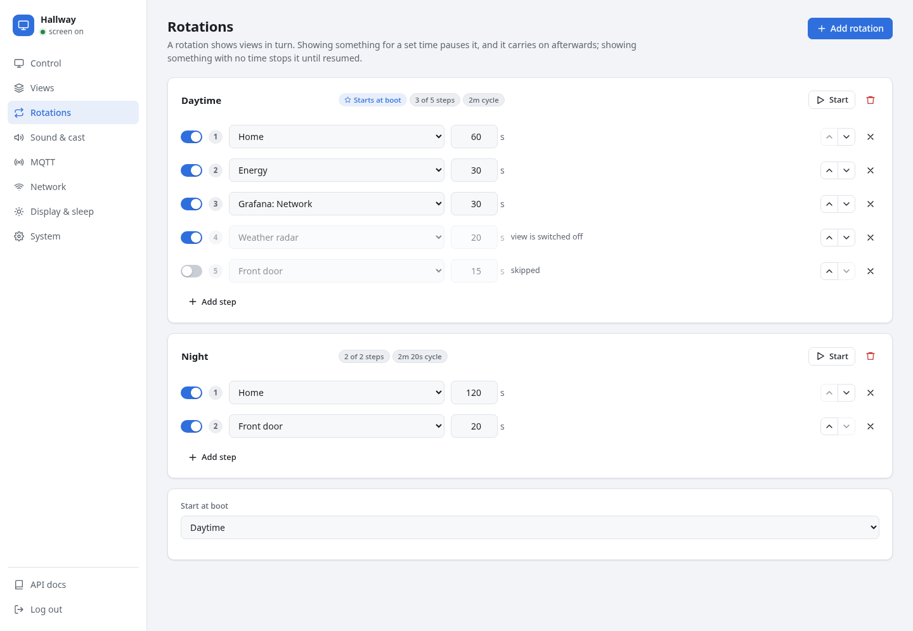
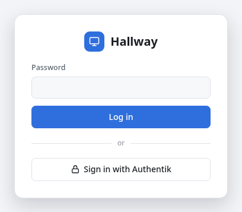
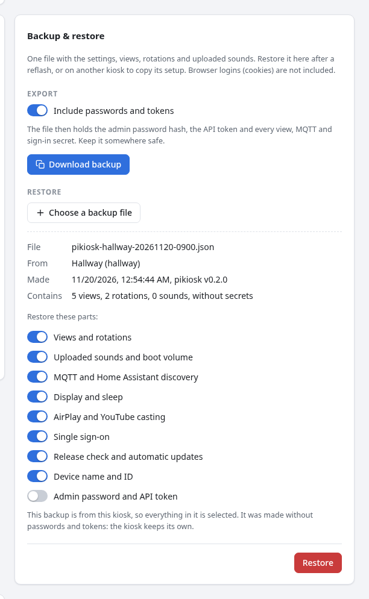

A big update: a redesigned web UI, YouTube casting, single sign-on, page preloading, release checks with automatic updates, backup and restore, and an image that installs without internet.



## Redesigned web UI

<picture>
  <source media="(prefers-color-scheme: dark)" srcset="https://raw.githubusercontent.com/XtremeOwnage/pikiosk/v0.2.0/docs-site/docs/assets/screenshots/control-dark.png">
  
</picture>

Sidebar navigation, status tiles, and a live remote for the screen. Views get a rotation switch on every row and a side panel for everything else:

<picture>
  <source media="(prefers-color-scheme: dark)" srcset="https://raw.githubusercontent.com/XtremeOwnage/pikiosk/v0.2.0/docs-site/docs/assets/screenshots/view-configure-dark.png">
  
</picture>

Rotations can skip a single step, show their cycle length, and **preload the next page in a hidden tab** so dashboards appear fully drawn instead of flashing a loading screen.

<picture>
  <source media="(prefers-color-scheme: dark)" srcset="https://raw.githubusercontent.com/XtremeOwnage/pikiosk/v0.2.0/docs-site/docs/assets/screenshots/rotations-dark.png">
  
</picture>

## YouTube casting

The kiosk shows up under the cast button in the YouTube app, like a smart TV. On networks where phones can't see the kiosk (another VLAN, or Wi-Fi with client isolation), **Link with TV code** pairs a phone through YouTube instead, and *Keep YouTube ready* lets it cast any time. [Details](https://xtremeownage.github.io/pikiosk/guides/sound-and-casting/#youtube-cast-button)

## Single sign-on



Sign in through Authentik, Keycloak or any OpenID Connect provider; the admin password keeps working. [Setup guide](https://xtremeownage.github.io/pikiosk/guides/single-sign-on/)

## Updates, backups and installs

<picture>
  <source media="(prefers-color-scheme: dark)" srcset="https://raw.githubusercontent.com/XtremeOwnage/pikiosk/v0.2.0/docs-site/docs/assets/screenshots/backup-dark.png">
  
</picture>

- **Release check** with an *Up to date* / *Update available* tag, **Update now**, and a Home Assistant update entity. Optional **automatic updates** in a time window you choose.
- **Backup and restore** to one file, with or without secrets; restore all of it, or copy a setup to another kiosk.
- **The image installs without internet**: every package is already on it.
- **Install without reflashing** on an existing Raspberry Pi OS Lite (64-bit, trixie):

  ```bash
  curl -fsSL https://github.com/XtremeOwnage/pikiosk/releases/latest/download/get.sh | sudo bash
  ```

<br clear="right">

## Install or upgrade

| | |
| --- | --- |
| New kiosk | Flash `pikiosk-v0.2.0-raspios-arm64.img.xz` with Raspberry Pi Imager. [Installation guide](https://xtremeownage.github.io/pikiosk/getting-started/installation/) |
| Existing Raspberry Pi OS | Run `get.sh` above. |
| v0.1.0 kiosks | **System → Update** in the web UI installs this release. |

Each file has a `.sha256` next to it. The full list of changes is in the [changelog](https://xtremeownage.github.io/pikiosk/changelog/).

**Not yet tested on hardware:** booting the new image completely offline, and casting from a real phone over AirPlay. The NixOS image is still experimental.
