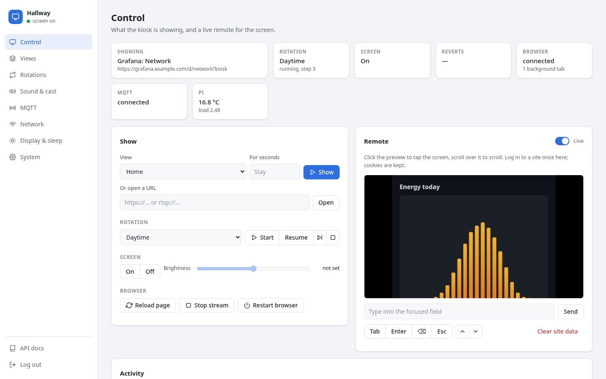

# pikiosk

Turn a Raspberry Pi and a monitor into a wall display that you control from Home Assistant. It can:

- show web dashboards and camera streams, and rotate through them
- play chimes and announcements, and work as a speaker for Home Assistant
- accept AirPlay from Apple devices, and show up under the cast button in the YouTube app
- preload the next page of a rotation, so dashboards appear fully drawn

Every action is available over MQTT (with Home Assistant discovery), a REST API and a built-in web interface.

It needs no cloud services, accounts or telemetry, and it runs fully without internet access, first boot included. Internet is only used when you press Update, by an optional twice-daily release check, and for sites you point it at ([details](https://xtremeownage.github.io/pikiosk/operations/offline/)).

**Documentation: <https://xtremeownage.github.io/pikiosk/>**

<picture>
  <source media="(prefers-color-scheme: dark)" srcset="docs-site/docs/assets/screenshots/control-dark.png">
  
</picture>

## Quick start

You need a 64-bit Raspberry Pi (5, 4, 400 or 500), a microSD card of 8 GB or more, and a monitor. No internet is needed.

1. Download `pikiosk-<version>-raspios-arm64.img.xz` from the [latest release](https://github.com/XtremeOwnage/pikiosk/releases/latest).
2. Flash it with Raspberry Pi Imager: *Use custom* → the image. Answer **No** to OS customisation.
3. Optional, on the card's `bootfs` partition:
   - copy `wifi.txt.example` to `wifi.txt` and fill it in
   - copy `authorized_keys.example` to `authorized_keys` and add your SSH public keys
4. Boot the Pi. The first boot sets up pikiosk (a few minutes) and reboots.
5. Open the address shown on screen, for example `http://pikiosk.local`, and choose an admin password.

## Features

| | |
| --- | --- |
| **Web pages** | Any URL, including sites that need a login. Per-view headers, basic or bearer auth, Home Assistant tokens, custom CSS, zoom and auto-refresh. |
| **Streams** | RTSP, HTTP, SRT and more, full screen. |
| **Rotations** | Named profiles. A timed view pauses the rotation, which then carries on. Views can be switched off without removing them. |
| **Sound** | Built-in chimes, uploads or URLs; a DLNA renderer so Home Assistant can use the kiosk as a speaker. |
| **Casting** | AirPlay receiver (UxPlay) for screen mirroring, video and music. |
| **Screen** | Power, brightness over DDC/CI, rotation, scale, idle timeout, daily schedule, wake on touch. |
| **Remote control** | Live preview in the web UI; tap and type into the page. |
| **Self-healing** | Hardware, service, browser, display and network watchdogs. |
| **Updates** | System packages and new pikiosk releases from the web UI, with no reflash. |

## Examples

```bash
mosquitto_pub -t pikiosk/hallway/cmd -m '{"action":"view","name":"doorbell-cam","duration":60}'
```

```bash
curl -X POST http://pikiosk.local/api/sound/play -H "Authorization: Bearer $TOKEN" \
  -H 'Content-Type: application/json' -d '{"path":"doorbell"}'
```

See the [MQTT](https://xtremeownage.github.io/pikiosk/reference/mqtt/) and [REST API](https://xtremeownage.github.io/pikiosk/reference/rest-api/) references. The kiosk also serves its API docs at `/api.html`.

## Development

```bash
go test ./...
```

```bash
nix build .#checks.x86_64-linux.vm
```

```bash
deploy/raspios/deploy.sh admin@pikiosk.local
```

The last command builds kioskd for arm64 and reinstalls it on a running kiosk. See [Development](https://xtremeownage.github.io/pikiosk/development/).

## License

[MIT](LICENSE). Third-party software installed on the kiosk keeps its own license; see [THIRD_PARTY.md](THIRD_PARTY.md).
