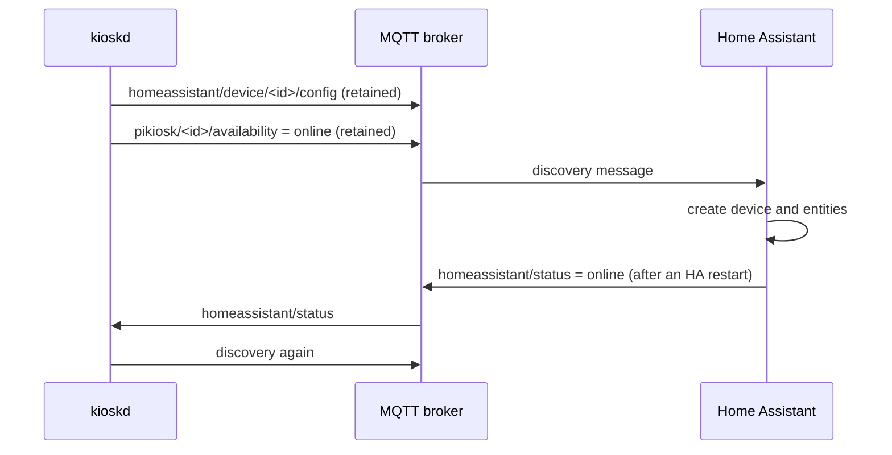

# Home Assistant

## MQTT discovery

On the **MQTT** tab, enter your broker and leave *Home Assistant discovery* on. Home Assistant then adds a device with:

- **Controls**: view and rotation selectors, URL, stream and sound text fields, screen switch, and brightness and volume sliders
- **Buttons**: reload, next, resume and stop rotation, stop stream, stop sound, restart browser, reboot
- **Sensors**: mode, rotating, casting, CPU temperature, IP address, boot time, last activity, browser restarts

The base topic defaults to `pikiosk/<device id>`. All topics are listed in the [MQTT reference](../reference/mqtt.md).

### How discovery is published

The kiosk uses Home Assistant's **device-based discovery** (Home Assistant 2024.12 or newer): one retained message describes the device and every entity, on

```
homeassistant/device/<device id>/config
```

Home Assistant names the device after the kiosk's **device name** (System → Device, *Kiosk* by default), so look for that name under Settings → Devices & services → MQTT. There are no per-entity topics such as `homeassistant/sensor/…/config`, so an MQTT browser shows a single topic under `homeassistant/device/`.



The kiosk publishes it when it connects, when a view or rotation is added or renamed, and when Home Assistant announces `online` on `homeassistant/status`.

The **Home Assistant discovery** card on the MQTT page has:

- **Republish now**, which sends discovery, state, sound list and availability again
- **Clear retained messages**, which deletes them from the broker. Home Assistant removes the device until it is published again, by Republish or the next reconnect. Use it to start fresh after renaming the device ID, or before removing a kiosk.

If the device does not appear, check that the broker user may publish to `homeassistant/#`, and look for `discovery published` or `discovery publish failed` in `journalctl -u pikiosk`.

## Dashboards without a login

Pick one:

1. **Long-lived token** (recommended): on the Views tab, open the view's **Configure** panel, choose *Home Assistant long-lived token* and paste the token.
2. **Log in once** through the remote preview on the Control tab. Chromium keeps the session.
3. **Trusted networks**: add the kiosk's IP address to Home Assistant's `trusted_networks` auth provider.

## Using the kiosk as a speaker

pikiosk runs a DLNA media renderer. Add it in Home Assistant with *Settings* → *Devices & services* → *Add integration* → **DLNA Digital Media Renderer**. It appears as a media player named after the kiosk.

```yaml
action: tts.speak
target:
  entity_id: tts.piper
data:
  media_player_entity_id: media_player.hallway_kiosk
  message: The washing machine has finished.
```

To play a sound from the kiosk's own library instead:

```yaml
action: mqtt.publish
data:
  topic: pikiosk/hallway/cmd/play_sound
  payload: doorbell
```

## Automations

Show the doorbell camera for a minute when someone rings:

```yaml
triggers:
  - trigger: state
    entity_id: binary_sensor.doorbell
    to: "on"
actions:
  - action: mqtt.publish
    data:
      topic: pikiosk/hallway/cmd
      payload: '{"action":"view","name":"doorbell-cam","duration":60}'
  - action: mqtt.publish
    data:
      topic: pikiosk/hallway/cmd/play_sound
      payload: doorbell
```

Turn the screen off when everyone leaves:

```yaml
triggers:
  - trigger: state
    entity_id: group.family
    to: not_home
actions:
  - action: switch.turn_off
    target:
      entity_id: switch.hallway_kiosk_screen
```
