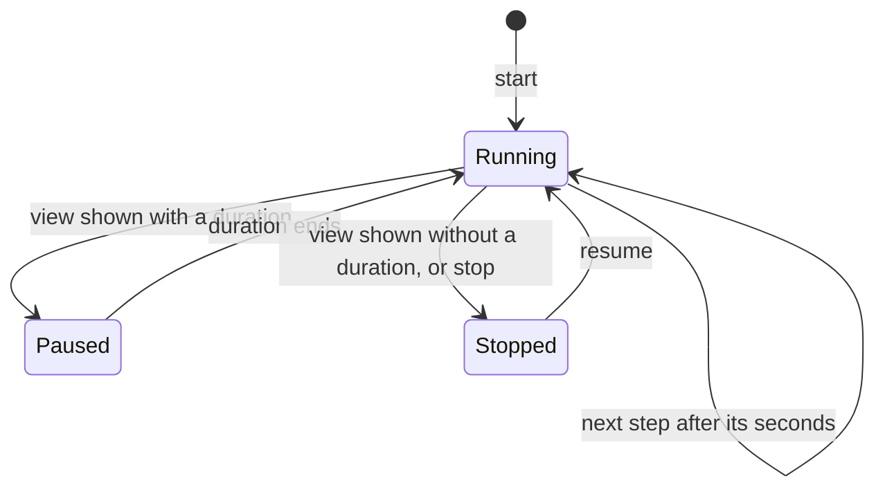
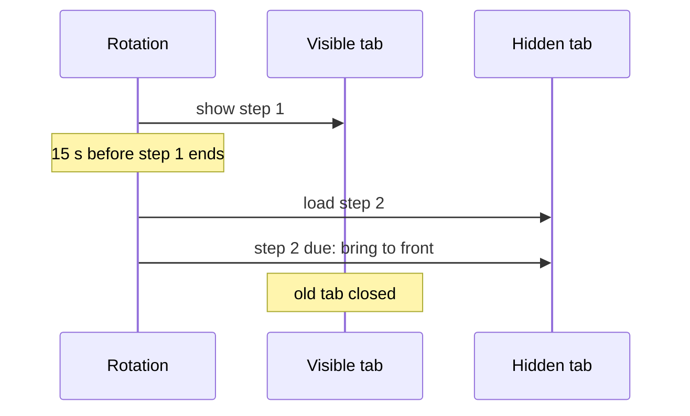

# Rotations

A rotation shows its views in turn, each for a set number of seconds (at least 3). You can keep several rotations, for example `daytime` and `night`, and switch between them from Home Assistant.

## Behaviour

| Event | What happens |
| --- | --- |
| A rotation starts | It shows its first view. |
| A view is shown **with** a duration | The rotation pauses. When the time is up it carries on from where it was. |
| A view is shown **without** a duration | The rotation stops. **Resume** continues it from where it stopped. |
| A step is switched off, or its view is | The rotation skips it. If every step is skipped, the screen stays as it is until one is switched back on. |
| A rotation is edited while running | The changes apply right away. |



**Start at boot** on the Rotations tab picks a rotation to run when the kiosk starts. Without one, the default view shows.

## Preloading

While a step is on screen, the kiosk loads the next web step in a hidden browser tab, about 15 seconds before it is due (or after a third of the step, for short steps). When its turn comes the tab is brought to the front, so the page appears fully drawn instead of showing its loading screen.



Only one page is preloaded at a time. Streams are not preloaded. Showing the page that is already on screen does not reload it; use **Reload every** on the view for that.

For pages you come back to often, switch on **Keep loaded in the background** in the view's Configure panel. The page then stays running in a hidden tab after another view is shown, so it is instant and up to date every time. Up to 3 hidden tabs are kept; the least recently used one is closed first. Each one costs memory (a heavy dashboard can take 200 MB or more), so on a 2 GB Pi keep it to one or two.

## Editing

Each rotation is a card with its steps. A step is a view and the seconds it stays on screen. The card shows how many steps are active and how long one cycle takes.

| Control | |
| --- | --- |
| Switch on a step | Skip this step in this rotation only. The view stays in other rotations. |
| ↑ ↓ ✕ | Reorder or remove the step. |
| **Add step** | Append a step. |
| **Start** | Start this rotation now. |

Changes are kept on the page until you press **Save rotations** in the bar at the bottom, or **Discard**.

## Switching a view off everywhere

The switch next to a view on the Views page skips it in every rotation. A step whose view is switched off shows *view is switched off*. You can also send a command:

```bash
mosquitto_pub -t pikiosk/hallway/cmd/disable_view -m weather
mosquitto_pub -t pikiosk/hallway/cmd/enable_view -m weather
```

A switched-off view keeps its place in every rotation and can still be shown directly.

## Commands

| MQTT topic | REST | |
| --- | --- | --- |
| `…/cmd/rotation` = name | `POST /api/rotation` | Start from the first view. |
| `…/cmd/resume_rotation` | `POST /api/rotation/resume` | Resume, or start the boot rotation. |
| `…/cmd/stop_rotation` | `POST /api/rotation/stop` | Stay on the current view. |
| `…/cmd/next` | `POST /api/rotation/next` | Skip ahead. |
