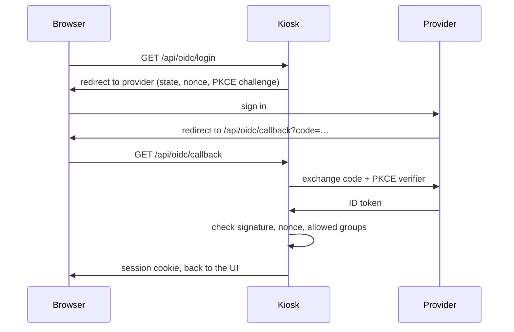

# Single sign-on

The web UI can sign users in through an OpenID Connect provider. The admin password keeps working alongside it, so a broken provider never locks you out. The REST API keeps using the API token.

## Provider setup

Create an OAuth2/OpenID application for the kiosk:

| Setting | Value |
| --- | --- |
| Client type | **Public** (the kiosk uses PKCE and holds no secret). Confidential also works; enter its secret in the kiosk. |
| Grant | Authorization code |
| Redirect URI | `http://<kiosk address>/api/oidc/callback`, for every address you open the UI at (hostname and IP). The kiosk shows the one for the current address under **System → Single sign-on**. |
| Scopes | `openid`, `profile`, `email` |

=== "Authentik"

    1. **Applications → Providers → Create → OAuth2/OpenID Provider**. Client type *Public*, redirect URIs as above, signing key set.
    2. **Applications → Create**, slug `pikiosk`, with that provider.
    3. Bind the users or groups that may sign in to the application.
    4. The issuer is `https://<authentik>/application/o/pikiosk/`.

    Authentik's `profile` scope includes the `groups` claim, so **Allowed groups** works without extra mappings.

=== "Keycloak"

    1. **Clients → Create client**, OpenID Connect, client authentication off (public), standard flow on.
    2. Valid redirect URIs as above.
    3. The issuer is `https://<keycloak>/realms/<realm>`.

    Add a *Group Membership* mapper with claim name `groups` to use **Allowed groups**.

## Kiosk setup

Under **System → Single sign-on (OIDC)**:

| Field | |
| --- | --- |
| Issuer URL | The provider's issuer. The kiosk reads `<issuer>/.well-known/openid-configuration` and refuses to save if it cannot. |
| Client ID | From the provider. |
| Client secret | Empty for a public client. |
| Allowed groups | Optional, comma separated. The user must be in one of them. Without it, anyone the provider lets through can sign in, so restrict access in the provider. |
| Button label | Text on the login page, for example *Sign in with Authentik*. |
| Redirect URI | Leave empty to use the address in the browser. Set it if the kiosk sits behind a reverse proxy that changes the host. |

Switch it on and save. The login page then shows the sign-in button under the password form, and the sidebar shows who is signed in.

## Troubleshooting

| Message on the login page | Cause |
| --- | --- |
| *cannot reach the sign-in provider* | The kiosk cannot fetch the issuer's discovery document. Check DNS and that the kiosk can reach the provider over HTTPS. |
| *redirect_uri mismatch* or a provider error page | The redirect URI registered at the provider does not match the address you opened the kiosk at. |
| *sign-in expired, try again* | The sign-in took over 10 minutes, the kiosk restarted in between, or the browser blocked the kiosk's cookie. |
| *… is not in an allowed group* | The user is not in **Allowed groups**, or the provider does not send a `groups` claim. |

Sessions last 7 days and are kept in memory: restarting kioskd signs everyone out.
