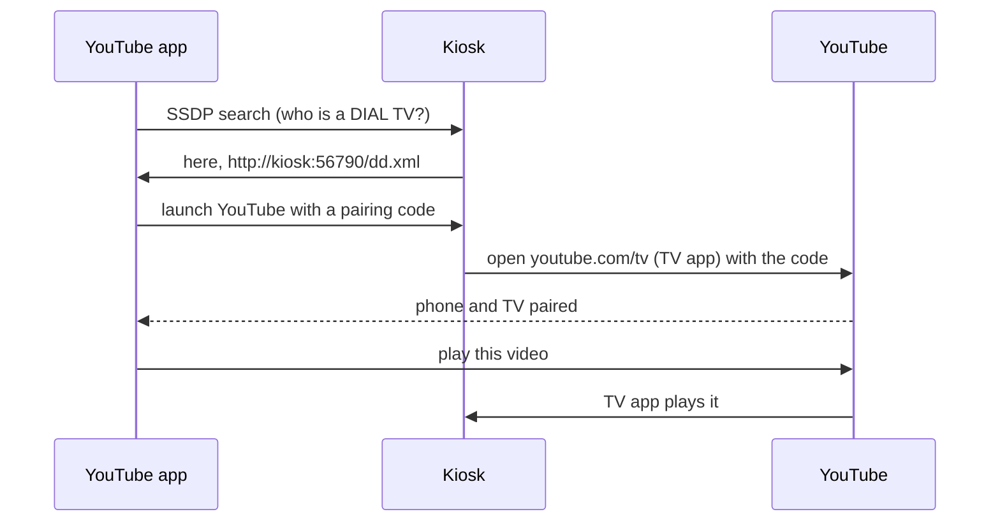

# Sound and casting


## Audio output

The Pi 5 has no headphone jack, and DVI cables carry no sound. Use HDMI to a monitor with speakers, or a USB speaker or USB audio adapter. PipeWire picks the output automatically.

## Sound library

The **Sound & cast** tab lists the built-in sounds (`chime`, `doorbell`, `alert`, `success`) and your uploads. Upload mp3, ogg, opus, wav, flac, m4a or aac files.

`play_sound` accepts:

- a library name: `doorbell`
- a path inside the library
- an `http(s)` URL, for example a Home Assistant TTS proxy URL

Paths outside the library are refused.

```json
{"action": "play_sound", "name": "doorbell", "volume": 80}
```

*Apply this volume at every boot* stores the slider's value and sets it at startup.

## DLNA

Home Assistant and DLNA apps see the kiosk as a media renderer. See [Using the kiosk as a speaker](home-assistant.md#using-the-kiosk-as-a-speaker). Android phones can send music and video to it with an app such as BubbleUPnP.

## AirPlay

pikiosk runs [UxPlay](https://github.com/FDH2/UxPlay), an open-source AirPlay receiver. iPhones, iPads and Macs on the same network can:

- mirror their screen (Control Center → *Screen Mirroring*)
- play video from apps that support AirPlay
- play music through the kiosk's speaker

The cast covers the screen until the device disconnects; then the kiosk is back where it was. While a device is connected:

- the state reports `casting: true` and Home Assistant's *Casting* sensor is on
- `cast_started` and `cast_ended` events appear in the activity feed
- a screen that was asleep wakes up, if *Wake when a view or stream is shown* is on

| Setting | |
| --- | --- |
| AirPlay receiver | On by default. |
| Ask new devices for a PIN | Shows a 4-digit code on the kiosk the first time a device connects. |
| Name shown to devices | Defaults to the device name. |

AirPlay uses mDNS for discovery and TCP/UDP ports 7100-7102. Devices on another VLAN need an mDNS reflector and those ports open.

## YouTube cast button

The kiosk shows up under the cast button in the **YouTube app** on Android and iPhone, the same way smart TVs do. Pick it, and the video plays on the kiosk while the phone stays the remote: play, pause, seek, queue and volume all work from the YouTube app.



Behind the scenes the kiosk answers DIAL, the discovery protocol smart TVs use, and opens YouTube's own TV web app in its browser. YouTube links the two; the kiosk never sees your account or what you watch.

| | |
| --- | --- |
| Switch | **YouTube cast button** under Sound & cast. On by default. |
| Name | The *Name shown to devices*, like AirPlay. |
| While casting | The rotation pauses, the state reports `casting: true` with `cast_source: "youtube"`, and Home Assistant's *Casting* sensor is on. |
| Ending | Disconnect in the YouTube app, press **Stop casting**, send `stop_cast`, or leave nothing playing for 2 minutes. The kiosk then goes back to what it was showing. |
| Network | Phones find it over SSDP (UDP 1900, multicast) and launch it on TCP 56790. Phones on another VLAN need SSDP forwarded. |

### The kiosk does not show up in the YouTube app

Phones find the kiosk with SSDP multicast, which routers do not pass between networks. The phone and the kiosk must be on the **same Wi-Fi network or VLAN**. Google Cast devices such as a Chromecast or Nvidia Shield can still show up from another VLAN, because they are found over mDNS, which many routers do forward; that does not help the kiosk.

The **Sound & cast** card shows the last time a phone's search reached the kiosk. *No phone has looked for TVs here yet* means the phone's searches never arrive. To fix it, either:

- connect the phone to the kiosk's network (or move the kiosk to the phone's), or
- forward SSDP (UDP 1900 to 239.255.255.250) between the two networks with an SSDP or UPnP relay on the router, and allow TCP 56790 from the phone's network to the kiosk.

This is YouTube only, and the videos come from YouTube, so it needs internet while you use it. Other Android apps can send media over [DLNA](#dlna).

!!! note "Chromecast"
    Google Cast itself (the cast button in other apps, and Android screen casting) only works with receivers certified by Google, so no open-source device can offer it. The YouTube cast button above uses YouTube's TV protocol instead, which is why it works in the YouTube app only.
