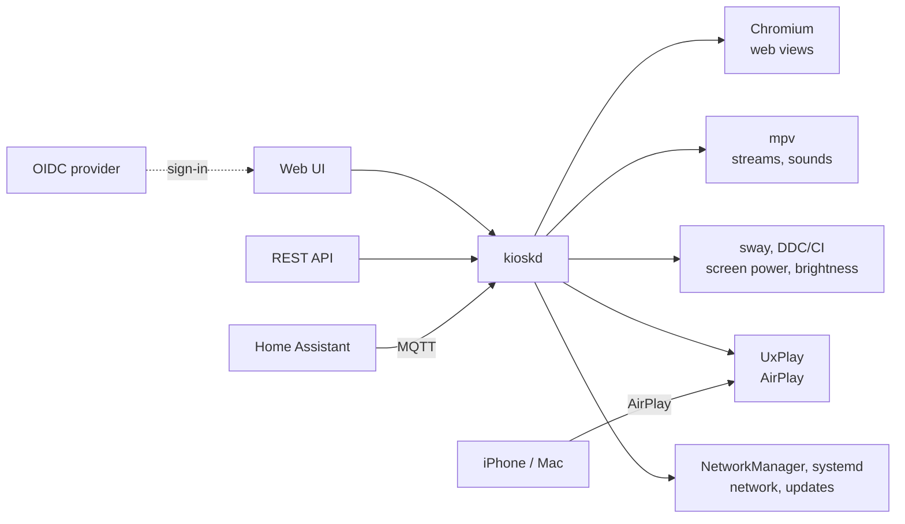

# pikiosk

pikiosk turns a Raspberry Pi and a monitor into a wall display that you control from Home Assistant. It can:

- show web dashboards and camera streams, and rotate through them
- play chimes and announcements, and work as a speaker for Home Assistant
- accept AirPlay from Apple devices

Every action is available over MQTT (with Home Assistant discovery), a REST API and a built-in web interface.

It needs no cloud services, accounts or telemetry. Everything it does stays on your network, and once installed it runs [without internet access](operations/offline.md).

[Install it](getting-started/installation.md){ .md-button .md-button--primary } [REST API](reference/rest-api.md){ .md-button }

## What it can do

| | |
| --- | --- |
| **Web pages** | Any URL, including sites that need a login. A page stays up until changed, or for N seconds. Per-view headers, HTTP basic or bearer auth, Home Assistant tokens, custom CSS, zoom and auto-refresh. |
| **Streams** | RTSP, HTTP, SRT and more, full screen. |
| **Rotations** | Named profiles that cycle through views. A timed view pauses the rotation, which then carries on. Views can be switched off without removing them from rotations. |
| **Sounds** | Built-in chimes, your own uploads, or any URL, such as Home Assistant TTS. |
| **Home Assistant speaker** | A DLNA media renderer, so `tts.speak` and media players can target the kiosk. |
| **Casting** | An AirPlay receiver for screen mirroring, video and music from iPhones, iPads and Macs. |
| **Screen control** | On/off, brightness over DDC/CI, rotation, scale, idle timeout, daily schedule, wake on touch. |
| **Remote control** | Live preview in the web UI; tap and type into the page to log in to sites. |
| **Status** | State, device health and an activity feed over MQTT and in the web UI. |
| **Self-healing** | Hardware watchdog, service watchdog, browser and display health checks, network watchdog. |
| **Remote fixes** | Updates from the web UI, SSH with keys, and one-command redeploys. You never need to reflash. |

## How it works

The stock Raspberry Pi OS Lite image gets a small first-boot config that:

1. installs Chromium, sway, mpv, PipeWire and the pikiosk daemon (`kioskd`)
2. logs a locked-down `kiosk` user into a bare sway session

kioskd drives Chromium over the DevTools protocol on loopback. It plays streams and sounds with mpv, and supervises the AirPlay receiver. Settings live in `/var/lib/pikiosk/config.json`.
