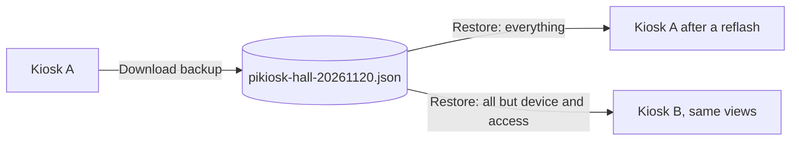

# Backup and restore

**System → Backup & restore** saves the kiosk's setup to one JSON file and loads it back. Use it before a reflash, to move to a new SD card, or to set up a second kiosk like the first.

## What is in a backup

| Part | |
| --- | --- |
| Views and rotations | Every view with its sign-in, headers, CSS and other settings, the rotations, the default view and the boot rotation. |
| Sounds | Uploaded sounds (the built-in ones come with pikiosk) and the boot volume. |
| MQTT | Broker, credentials, topics and Home Assistant discovery. |
| Display and sleep | Rotation, scale, brightness, cursor, idle timeout and schedule. |
| Casting | AirPlay and YouTube settings. |
| Single sign-on | Issuer, client and allowed groups. |
| Updates | Release check and automatic update window. |
| Device | Name and ID, which set the MQTT topics and Home Assistant entity IDs. |
| Access | The admin password (as its hash) and the API token. |

Not included: logins made in the kiosk's browser (cookies and site data), network and Wi-Fi settings, and the timezone.

## Export

Press **Download backup**. With **Include passwords and tokens** on, the file holds everything above, secrets included; keep it somewhere safe. With it off, every password, token and header value is `********` and the admin password and API token are left out.

## Restore

1. **Choose a backup file**. The kiosk shows where it came from, when, and what it holds.
2. Pick the parts to restore. A backup from this kiosk selects everything; one from another kiosk leaves out its device name, ID and login, so the copy keeps its own identity.
3. Press **Restore**.

The selected parts replace the kiosk's current settings and take effect right away. Secrets shown as `********` in the backup keep the values the kiosk already has, so a backup without secrets never wipes them.



## Over the API

```bash
curl -H "Authorization: Bearer $TOKEN" -o backup.json http://pikiosk.local/api/backup
```

```bash
jq '{backup: ., sections: ["views", "sounds"]}' backup.json \
  | curl -H "Authorization: Bearer $TOKEN" -H 'Content-Type: application/json' \
      --data-binary @- http://pikiosk.local/api/backup/restore
```

`GET /api/backup?secrets=0` exports without secrets. See the [REST API](../reference/rest-api.md#backup).
